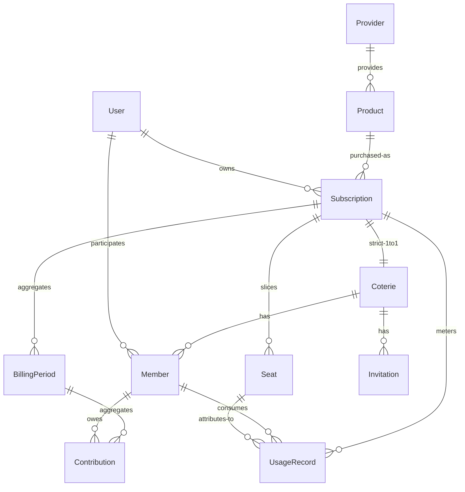

# Coterie Design Plan

| | |
|---|---|
| Status | Draft |
| Document version | v0.1 |
| Related documents | [Overall Plan](/project-plan) · [Requirements](/requirements) |

This document is the basis for refactoring and implementation: domain model, sharing model, billing/payment, technical architecture, module breakdown, API and deployment.

---

## 1. Domain Model

Overview (exact cardinalities in [§1.2](#12-entity-relationships-er)):

```text
Provider
    │
    ▼
Product
    │
    ▼
Subscription ── Seats (capacity slicing)
    │                ▲
    │ strict 1:1     │ allocation: who takes which seat
    ▼                │
  Coterie ── Member ─┘
      │
      ├── Invitation
      └── BillingPeriod ── Contribution
```

Correspondence between the model and the design principles:

| Concept | Corresponding principle |
|------|----------|
| Separation of Provider / Product / Subscription | Principle 1 (Generic First), Principle 2 (Subscription ≠ Account) |
| The Coterie at the core | Principle 4 |
| Member is a platform user, not a third-party account | Principle 3 (Member ≠ Account) |
| Subscription holds no password | Principle 8 (Secret Is Optional) |

### 1.1 Concept Definitions

Every concept is defined in both directions — "what it is / what it is not" — to draw the identity boundary. Field-level requirements are in [Requirements FR-1 through FR-9](/requirements#4-functional-requirements); this section only answers "what is this concept, and where is its boundary".

| Concept | What it is | What it is not | Key fields |
|------|--------|----------|----------|
| **User** | Platform identity: the person who logs in, globally unique | Not a third-party account; stores no Provider credentials | id, username, email, locale, timezone, status |
| **Provider** | A **catalog entry** (metadata) of a digital-service provider, describing "who provides the service" | Not a subscription; carries no plan or price | id, name, category |
| **Product** | A **purchasable plan** (plan/SKU) of a Provider, describing "what is bought" | Not a purchased instance; the actually paid price belongs to the Subscription | provider_id, name, tier |
| **Subscription** | A **concrete purchase** — a subscription instance, and the **single source of truth for cost and capacity**: unique Owner, billing cycle, actual price, Sharing Policy, Seat capacity | Not an account (holds no credentials), not a sharing circle (the social structure is kept separate) | product_id, owner_user_id, billing_cycle, price, currency, renewal_date, status, max_seats |
| **Coterie** | A **sharing circle** (collaboration structure) organized around **exactly one Subscription**: members, roles, invitations and cost splitting all happen inside the circle | Holds no capacity (capacity comes from the subscription), holds no credentials | subscription_id (globally unique), name, status |
| **Member** | A user's **participation record** in a Coterie (role + status + join/leave timestamps) | Not a Seat (a seat is a resource, a member is a person), not a third-party account | coterie_id, user_id, role, status, joined_at, left_at |
| **Seat** | The **slicing unit of** Subscription capacity, and simultaneously the **generic allocation unit** (reused by the Quota pattern, see D4) | Not a member (it can be idle), not account credentials | subscription_id, label, status, metadata |
| **BillingPeriod** | One **billing interval** of a Subscription, the aggregation unit for Contribution | — | subscription_id, start_date, end_date, status |
| **Contribution** | A member's **cost-splitting record** within a billing period | Not a payment transaction (payment is an Adapter, see [§4.2](#42-payment-architecture)) | billing_period_id, member_id, amount, currency, status |
| **UsageRecord** | One **usage record** (append-only ledger): a single metered consumption by a member inside the subscription, attributable to one seat they occupy | Not a payment transaction, not the quota itself (the quota is Seat metadata, see D4); records are append-only, corrections are written as negative entries | subscription_id, member_id, seat_id, amount, unit, recorded_at |
| **SharingPolicy** | The **sharing rules** (mode + limits) attached to a Subscription; data-driven rather than code branches | Not an if-provider in the business logic | mode, limits (JSONB) |
| **Invitation** | The **credential** for entering a Coterie (token, expiry, role) | Not a member record; a Member is created only after acceptance | coterie_id, token, role, expire_at |

Three identity-boundary principles (corresponding to design principles #2 / #3 / #8):

- **Subscription ≠ Account**: Seats / Quota / Access only exist beneath a subscription, and credentials never enter the core model;
- **Member ≠ Account**: Member is the projection of a platform identity inside a circle, unrelated to any third-party account;
- **Seat ≠ account**: a Seat is an allocation unit that can sit idle, be transferred, or be reclaimed.

### 1.2 Entity Relationships (ER)



Cardinalities at a glance (**bold marks key decisions**):

| Relationship | Cardinality | Note |
|------|------|------|
| Provider → Product | 1 : N | one provider, many plans |
| Product → Subscription | 1 : N | the same plan can be purchased many times |
| User → Subscription | 1 : N | as Owner |
| **Subscription → Coterie** | **1 : 1 (strict)** | `coteries.subscription_id` globally UNIQUE (D1) |
| **Subscription → Seat** | **1 : N** | capacity slicing; seats belong to the subscription (D2) |
| Subscription → BillingPeriod | 1 : N | costs aggregated per period |
| Coterie → Member | 1 : N | participation records |
| User → Coterie | N : M | via Member |
| **Member → Seat** | **0..1 : 0..N** | one member may occupy multiple seats; at any moment each Seat has at most one occupant and may be idle. The MVP expresses this with a nullable `seats.member_id` foreign key; history is kept in the Audit Log |
| BillingPeriod → Contribution | 1 : N | |
| Member → Contribution | 1 : N | |
| Subscription → UsageRecord | 1 : N | usage ledger (Phase 2 Usage Tracking); member attribution, optional seat aggregation (D9) |

### 1.3 Aggregate Boundaries and Ownership

Two aggregate roots plus a set of catalog entities:

```text
Catalog (directory, weak transaction)
└── Provider ── Product

Subscription aggregate root (source of capacity and cost)
├── Seat[]
├── SharingPolicy
├── UsageRecord[]
└── BillingPeriod[]

Coterie aggregate root (collaboration structure)
├── Member[]
├── Invitation[]
├── Contribution[] (references billing_period_id)
└── references Subscription (ID only)
```

Rules:

- **Transaction boundary is the aggregate boundary**: changing Seat / SharingPolicy / BillingPeriod is a Subscription aggregate transaction; changing Member / Invitation / Contribution is a Coterie aggregate transaction;
- **Only IDs are stored across aggregates**: `coteries.subscription_id`, `contributions.billing_period_id`; the other aggregate's objects are never persisted;
- **Cross-aggregate coordination goes through domain events**: for example `billing_period.closed` → notify, `member.joined` → recompute the full flag; see `pkg/events`.

### 1.4 Key Invariants

1. **Strict 1:1**: `coteries.subscription_id` is globally unique; one subscription has at most one circle over its entire lifetime (D1);
2. **Owner identity**: the Coterie creator must be the Subscription.owner (D5); the MVP does not allow separation, and transfer is deferred to Phase 2 (on transfer the subscription and the circle change owner together);
3. **Capacity**: the number of active Seats ≤ `subscription.max_seats`; a Coterie **does not store capacity separately**, and the `capacity` parameter of the create API means "create N Seats for this subscription" (a corollary of D1 + D2);
4. **Valid allocation**: a Seat's occupant must be an active Member of the circle belonging to the same subscription;
5. **Currency consistency**: `contributions.currency` must equal `subscriptions.currency` (the MVP is single-currency with no FX, D6);
6. **Period closure**: a Contribution must be attached to a BillingPeriod that exists and belongs to the same Subscription.

### 1.5 Coterie Lifecycle and State Machine

Five persisted states; `Full` is a derived flag (D3):

```text
Draft ──▶ Open ──▶ Active ⇄ Paused
   │        │        │
   └────────┴────────┴────▶ Closed (terminal)
```

| State | Meaning | Entry condition |
|------|------|----------|
| **Draft** | Created but not published | Create a Coterie (a Subscription must already be bound) |
| **Open** | Recruiting; can invite/join | Owner publishes |
| **Active** | Running for real; billing in effect | Owner starts it (the subscription takes effect / the first period begins) |
| **Paused** | Suspended: members and seats are kept, settlement is paused | Owner pauses; can resume to Active |
| **Closed** | Sharing ended | Owner closes / subscription terminates; terminal state |

Derived flag: `full = (number of idle Seats == 0)`.

- While in the **Open** state, a new member is refused when full is true;
- In every state it is shown as display information (for example "4/5 full");
- After a seat is released the flag clears automatically; **no state transition is involved**.

See [Requirements FR-5](/requirements#fr-5-coterie) for the behavioural semantics (who may do what).

### 1.6 Seat: The Universal Allocation Unit

A Seat carries both kinds of allocation; `sharing.mode` determines its semantics:

| Mode | Seat semantics | metadata example |
|------|-----------|---------------|
| Seat / Family / Account | one usable independent position | `{"label": "Slot 1"}` |
| Quota (D4) | one share of quota | `{"quota": 300, "unit": "credits", "used": 0}` |
| Resource (D23) | one share of a resource pool | `{"resource": 1024, "unit": "GB", "used": 0}` |

- State machine: `free / occupied / disabled`;
- Allocation: Seat ↔ Member (0..1 occupant), supporting idle, transfer and reclamation (FR-8);
- Quota adjustment = metadata update, no new entity;
- Writes to usage (`used`) are driven by the **Usage Record** (Phase 2 Usage Tracking): once ledger records are aggregated onto a seat, `used` is recomputed as the SUM of the records aggregated to that seat (a projection, see D9); the quota itself is never mutated by ledger rows;
- **Quota enforcement (closing out D4)**: when a record is aggregated onto a seat whose metadata carries a numeric `quota`, a post-write aggregated total above `quota` → 409 (same criterion as D21: the post-write total, negative corrections pass, malformed values are not blocked); when metadata carries a `unit`, the limit and the total count only records in that unit, and by default all aggregated records count.

### 1.7 Entity Design Notes

Field lists are in the corresponding requirements entries; here only implementation notes are recorded:

- **Provider / Product (catalog)**: Product stores no price; the actually paid price lives on the Subscription. The catalog can be built by users themselves through the Generic Provider ([§5.3](#53-generic-provider)), and it can also come from the Provider Registry ([§5.4](#54-provider-registry)).
- **Subscription**: aggregate root, owning Seats / SharingPolicy / BillingPeriods; its `status` is independent of Coterie.status. When a subscription expires while the circle still exists, notifications drive the circle into the Closed flow rather than cascading a hard delete.
- **Coterie**: stores no capacity (invariant 3) and no credentials of any kind (NFR-1); member and role semantics are in FR-7.
- **Member**: `UNIQUE(coterie_id, user_id)` guarantees at most one active record per user per circle; leaving is soft-recorded via `left_at`, and history is retained for settlement traceability.
- **Contribution**: generated in bulk per period by the Billing task; under Manual Settlement the settlement status is marked manually by the Owner (see [§4.2](#42-payment-architecture)).

### 1.8 Design Decision Records (ADR)

| # | Decision | Conclusion | Rationale and impact |
|---|------|------|------------|
| **D1** | Subscription ↔ Coterie cardinality | **Strict 1:1** (UNIQUE foreign key) | Seats, costs and settlement close the loop inside a single circle, which keeps the model simplest; if 1:N is needed later, extend it via migration |
| **D2** | Seat ownership | **Subscription** | The subscription is the only source of capacity: "the subscription sets the slots, the circle picks the people"; the Coterie stores no capacity field |
| **D3** | Full state | **Derived flag** | Removes the ambiguity in the original state machine where Full came before Active; the persisted states collapse to 5 |
| **D4** | Quota modeling | **Reuse Seat + metadata** | The Seat becomes a generic allocation unit, minimising the number of concepts; adjusting a quota is just a metadata update; post-write enforcement in D30 ([§1.6](#16-seat-the-universal-allocation-unit)) |
| **D5** | Owner identity | Coterie Owner ≡ Subscription Owner (MVP) | Under 1:1 the person financially responsible and the circle manager are naturally the same; transfer is a Phase 2 feature |
| **D6** | Currency | The MVP is single-currency with no FX | Contribution currency always equals the subscription currency; FX is deferred to the real-payment stage (Phase 2+) |
| **D7** | Data access layer | **GORM for CRUD; AutoMigrate disabled** | The single source of schema truth remains the hand-written migrations (`migrations/`), and DB-level invariants are guaranteed by migration constraints ([§1.4](#14-key-invariants)); GORM only maps queries/writes, and schema evolution is applied by golang-migrate at startup |
| **D8** | Platform authentication | **Email + password (bcrypt) + opaque Bearer session token** | Passwords are stored only as bcrypt hashes (nullable, leaving room for OAuth/Passkey); the session token is a 32B random value and the DB stores only its SHA-256 hash, so a leaked database still cannot be used for impersonation ([§6.1](#61-security-model)); OAuth / Passkey / OIDC plug in as extension points of the auth module and are not hard-wired into the core |
| **D10** | Circle exposure and join requests | **opt-in listing + JoinRequest** | A circle defaults to `listing=private` and only enters the directory when the Owner explicitly sets it to `public` (FR-16 constraint: a circle does not become a marketplace by default); a JoinRequest is single-active (at most one pending per circle per user), decided by the Owner/Admin, and acceptance runs the same admission checks as an invitation; the Marketplace itself is a **read-only directory + request inbox**, decoupled from the core through exported admission methods ([§12.3](#123-marketplace)) |
| **D9** | Usage accounting | **Append-only ledger + projection** | `usage_records` is append-only (corrections are negative records) and is the single source of truth for usage; `metadata.used` on a quota Seat is a SUM projection of the records aggregated to that seat, recomputed under a row lock at write time rather than accumulated incrementally (no floating-point drift, reconcilable); the `usage` split within a billing period uses each member's in-period usage ratio and the largest remainder method to distribute units, conserving the total exactly ([§4.1](#41-billing)) |
| **D11** | Payment Adapter | **Interface + built-in Manual + append-only ledger** | The `Adapter` interface (`Charge→Receipt`) is the only channel seam; `payments` is append-only, amount/currency always come from the Contribution (invariant 5), and posting the payment and flipping the Contribution to `paid` happen in the same transaction; the Owner or the paying member may record it; real channels (Stripe and similar) plug in as new adapters without touching the core ([§4.2](#42-payment-architecture)) |
| **D12** | Provider plugin surface | **Bound by slug + optional capability interfaces** | `Plugin` plus optional `PolicyValidator` (re-validate the subscription policy) / `AdmissionGuard` (refuse admission) / `UsageValidator` (re-validate usage accounting); an empty Registry means all-Generic semantics and the core has zero dependency on any specific Provider ([§5.1](#51-principles)); core admission also enforces `max_members` (MemberLimit) |
| **D13** | Billing automation | **Scheduler rolls periods + acts on the Owner's behalf** | Once `auto_billing` (a subscription-level switch, off by default) is enabled, an in-process scheduler (`AUTO_BILLING_INTERVAL`, default 1h, 0 disables it) — after the **frontier period** (the one with the greatest start_date) ends — opens the next period as the **Owner** through the same billing service and generates contributions with `equal`. Every invariant, including unique constraints, conservation and notifications, stays in force unchanged; monthly/yearly can infer the next interval, and `custom` infers it from the period length `cycle_days` (D20); the first period is always manual (the price and start date are Owner decisions); after a successful roll, the Owner receives a `subscription_renewal` notification with the previous period's unsettled count ([§4.1](#41-billing)) |
| **D14** | Dispute handling | **Independent ledger + advisory ruling** | The `disputes` table (reason/evidence/status + a decided_shape CHECK, at most one open per Contribution, enforced by a partial unique index); opened by a member or the Owner (cancelled contributions cannot be disputed), and ruled on one-way by the Owner (resolved/rejected, `decide` is a one-way atomic flip); **a ruling does not change the contribution**: when settlement actually needs adjusting, the Owner acts explicitly through the existing PATCH, keeping the dispute ledger decoupled from the movement of money; the `dispute_opened`/`dispute_decided` notifications extend the type list with a migration ([§4.3](#43-dispute)) |
| **D15** | Account reputation | **Purely derived + read-only projection** | Reputation is a projection of the contributions ledger, not a writable model: per user, count the status of their contribution records (paid/pending/waived/cancelled) and the paid/unpaid amounts per currency, with `payment_ratio` = paid ÷ (paid+pending) (counting only contributions that were ever owed; waived/cancelled never enter the denominator; no owed history → null rather than a false 100%). There is no manual scoring and no write surface, so nothing can be gamed; `GET /api/v1/users/{id}/reputation` (authenticated baseline) ([§4.4](#44-reputation)) |
| **D16** | Real plugin sample | **A `claude` plugin bound to a seeded catalog slug** | The first real implementation of the §5.2 plugin-surface contract, landing in `providers/claude/` (policy/admission/usage all three implemented): the policy requires `region ∈ {us,eu}` (data residency) plus an optional `plan ∈ {pro,max}` (defaulting to max); for admission, pro is a personal plan that rejects every join and a max circle holds at most 5 people; accounting accepts only `tokens`/`requests` with a per-record cap (negative corrections pass). **It binds to a seeded catalog entry rather than creating a new Provider row**: the plugin augments the semantics of an "already existing slug", keeping the catalog (§5.4) and the plugin (behaviour) decoupled; registered via `PROVIDER_PLUGINS=claude` (the same pattern as `PAYMENT_METHODS`, with unknown names warned and skipped); if not registered, the Provider stays Generic ([§5.2](#52-catalog-structure-and-a-real-sample)) |
| **D17** | Audit log | **Append-only ledger + same-transaction instrumentation + Owner-only reads** | FR-15 requires auditing money and membership changes: `audit_logs` is append-only (who/what/when/where/before/after), appended inside the existing business transaction, so a failed audit write rolls back the business write — the same discipline as "post and flip in one transaction" (D11); the action list is a CHECK enumeration extended by migrations; the read surface is the subscription Owner only (the subscription tree pivots on `subscription_id`, the circle on `coterie_id`); members get no audit reads (results are visible in their own views), and the Admin surface comes later ([§6.3](#63-audit-log-adr-d17)); instrumentation needs a trusted actor, so this batch also closes the Owner-enforcement gap on the subscription resource surface: **the owner is the authenticated user** (the `owner_user_id` payload can only confirm, never name, so create/read/list/update/delete all validate it across the whole surface, closing the M1 authorisation hole) |
| **D18** | Marketplace reputation display | **Purely derived badge** | Directory entries carry an Owner settlement-reputation badge (`owner`: user_id / username / contribution counts / `payment_ratio`); the aggregation reuses the same derivation as D15 (batch SQL isomorphic to the single-user report), with no separate scoring path; the badge is a coarse-grained public projection without per-currency amounts (amounts stay in the authenticated report endpoint); publishing a circle publicly (`listing=public`) is acceptance of the display slot; with no owed history ratio=null, never a false perfect score ([§4.4](#44-reputation)) |
| **D19** | Rate Limit | **In-memory fixed window** | Phase 1 only blocks the realistic abuse surface: unauthenticated public write endpoints are counted per (endpoint, client IP): register 5/min, login 10/min; over the limit returns a 429 JSON envelope + `Retry-After`; single-instance in-memory with no Redis (§7.4), and a config of 0 disables it; public reads and authenticated endpoints wait for a real traffic profile ([§6.4](#64-rate-limit)) |
| **D20** | Custom billing cycles | **A `cycle_days` day offset** | A billing period's semantics are "interval length" (explicit `[start,end]`, unique per start), and cron answers "when to trigger" while adding timezone/expression validation overhead, so this takes a **day offset**: `cycle_days` (an integer 1–365) is required when `billing_cycle='custom'` and must be empty otherwise, enforced both ways by a row-level CHECK; the scheduler (D13) infers the next period as `[end+1, end+cycle_days-1]` through the same pipeline as monthly/yearly; changes land in the `subscription_updated` audit snapshot |
| **D21** | Sharing Policy UsageLimit | **A core-side per-member per-period usage cap** | `sharing_policy.usage_limit = {"unit","per_period"}` (carried in JSONB, per §3's principle of no strongly-typed columns); enforced inside the `POST /usage-records` transaction before insert: for ledger rows matching `unit`, sum per member over the period containing `recorded_at` (`[start,end]`); if the **post-write new total** > `per_period` → 409; the criterion is the total rather than the increment, so negative corrections pass naturally; if no period covers it or the unit does not match, no limit applies (the ledger comes first; only the settlement view needs periods); comparisons use integers scaled by 1e4, eliminating floating point; the core validates `unit` (1–32 characters) and per_period (a positive decimal with at most 4 decimal places), and a plugin may stack a stricter validation in the same transaction (D12) |
| **D22** | Push notifications | **Web Push (RFC 8291 + RFC 8292 VAPID)** | The push channel uses the Web Push standard rather than FCM/APNs private channels (self-hosting friendly, no vendor credentials): a user registers `push_subscriptions` through the authenticated API (endpoint + p256dh/auth keys, endpoint globally unique with upsert); the outbound adapter POSTs to each registered endpoint of a notification recipient, encrypting the payload with RFC 8291 `aes128gcm` and signing the `Authorization` header with RFC 8292 VAPID (ES256 JWT), hand-rolled with pure stdlib + x/crypto/hkdf (both encryption and JWT are backed by RFC test vectors, with no third-party push library); a 404/410 from the push service prunes that subscription (the endpoint is dead), and other failures are logged per channel convention rather than treated as fatal (FR-12); if VAPID is not configured the channel does not register, the same behaviour as Email/Webhook ([§6.5](#65-web-push)) |
| **D23** | Resource sharing modeling | **Reuse D4: Seat + metadata** | §2.5 resource-pool sharing introduces no new entity: when `sharing.mode = resource`, a Seat's metadata carries `{"resource": <capacity>, "unit": "...", "used": 0}` (isomorphic to quota); the `used` projection follows exactly the same pipeline as quota: the ledger rewrites the seat-aggregated SUM (D9), and seat-aggregation discovery plus the multi-seat ambiguity check treat quota and resource alike; cost splitting (§4.3) is orthogonal to the sharing mode, so resource mode picks equal / usage splits as usual, with no new billing path |
| **D24** | Real payment channel (Stripe) | **An async adapter facet + public Webhook + pending/failed states** | A synchronous `Charge` (which posts the ledger on success inside the transaction) cannot express Stripe's confirm-then-callback flow, so the adapter surface gains an **optional async facet**: `AsyncAdapter` (`ChargeAsync → channel reference` + `ParseWebhook → event`), which synchronous adapters satisfy automatically (zero changes); `payments.status` is extended to `('pending','succeeded','failed')` by migration 0014 (a payment first lands as `pending`, and `paid_at` is backfilled on confirmation); the Stripe adapter uses **pure net/http + HMAC-SHA256** (no stripe-go: it only needs one form POST to `/v1/payment_intents` plus webhook signature verification, and an SDK buys nothing here); `POST /api/v1/payments/webhooks/stripe` is a **public endpoint** (the signature is the only authentication, with no session): verify signature → translate to a normalised event → the service layer writes back `payments` in the same transaction (succeeded sets `paid`/`paid_at` and flips the Contribution, failed only records the state), never reverse-driving the domain model; configured by `STRIPE_SECRET_KEY`/`STRIPE_WEBHOOK_SECRET`/`STRIPE_API_BASE` (the last points tests at a fake service), and if not configured the channel does not register (channel convention) |
| **D25** | Marketplace payment gate | **An admission-fee independent ledger + awaiting_payment + Webhook-driven joining** | The gate's semantics are "charge before joining, join on confirmation": `coteries.payment_gate` (Owner-only PATCH, off by default); once enabled, accept moves the request to `awaiting_payment` (Owner consent recorded, joining suspended) and the requester initiates the charge via `POST /api/v1/join-requests/{id}/payments`, with the amount computed by the platform (an equal-share basis, floor(price/(active members+1)), capped at price, with the currency following the subscription and the same source as the directory estimate); a synchronous channel settles on the spot and joins in the same transaction, while an async channel lands `pending` + `client_secret`; manual can only be recorded by the Owner (self-certifying payment is forbidden). Confirmation goes through a separate public Webhook, `POST /api/v1/marketplace/webhooks/{method}` (reusing D24's signature pipeline; `STRIPE_MARKETPLACE_WEBHOOK_SECRET` falls back to `STRIPE_WEBHOOK_SECRET` when absent): the same transaction re-runs every admission check and inserts the member (`admitUser` made transactional and reused) + flips the charge + moves the request to `accepted`, and a 409 on full rolls back with the channel retry self-healing. **The admission fee is recorded in a separate `admission_charges` ledger rather than `payments`**: invariant 5 requires amounts to come from a Contribution, and a Contribution presupposes membership while the gate deliberately runs first — the admission fee is an estimated receipt of the current period's share, it does not enter the settlement ledger, and after joining the real share is still billed out by billing generate. A failed charge can be repaid (a partial unique index guarantees at most one in-flight/succeeded charge per request); while a pending charge is in flight, decline/cancel returns 409 (money in transit); circles without the gate enabled are untouched |
| **D26** | Closing out anti-abuse + an Admin baseline | **A platform admin role + reports + circle-level blocks** | The final two NFR-7 items (Report / Block) and the FR-14 Reports responsibility close out together: a **platform admin** = `users.role` (`'user'`/`'admin'`, defaulting to user), bootstrapped at startup via `ADMIN_EMAILS` (an idempotent UPDATE; the instance operator is the admin, and self-hosting builds no admin-registration surface); the admin surface v1 only handles reports (FR-14 states plainly that the Admin does not take part in day-to-day circle management, so there is no user management or circle editing). **Report**: an authenticated user reports a publicly listed circle (a non-public circle still returns 404 without leaking its existence, with reason ≤1000 characters), into an independent `reports` ledger (open/resolved/dismissed + resolution_note, at most one open per user per circle), read and decided by an admin via `GET /api/v1/admin/reports` + `resolve/dismiss`; the decision does not notify the reporter (to avoid leaking handling detail), and it is audited. **Block** is circle-level rather than platform-level: the public directory plus the payment gate give malicious requests a real cost, and an Owner block is the most direct anti-abuse primitive (a platform-wide ban would be risk-control expansion, explicitly out of scope); a blocked user gets 403 on join requests and on every admission path (`admitUser`: invitation acceptance / marketplace accept / gate confirmation), while existing members are not automatically removed (the Owner can still remove them manually). Migrations land alongside the implementation (0016 role / 0017 block / 0018 report) ([§6.3](#63-audit-log-adr-d17), [§6.6](#66-anti-abuse-report-and-block)) |
| **D27** | The admin audit query surface | **A platform-level read-only audit endpoint** | The last piece of NFR-7's audit surface (the "Admin query surface" reserved by D17's read surface): `GET /api/v1/admin/audit-logs` (platform admin only, via D26's `requireAdmin`) queries the full ledger across subscriptions and circles, with `?action=` (validated against the known action list) / `?actor_id=` / `?coterie_id=` / `?subscription_id=` filters, `created_at DESC` ordering, and the standard pagination envelope. It shares the same append-only table as the Owner read surface, likewise has no edit/delete surface, and adds no migration |
| **D28** | Closing out the M2a batch | **PR #3 merged; the m2a-auth-implementation branch archived** | Platform authentication (D8) + a single-port full stack (Vite artifacts embedded via go:embed, a multi-stage Dockerfile, SPA fallback) + the dashboard write surfaces (billing-period writes, invitation joining, the notification inbox, the marketplace directory, the Owner request inbox including the D25 payment gate, usage accounting including the D21 cap, and dispute filing and ruling) merged into main as one batch via PR #3 on **2026-10-10** (merge commit `74548e8`, CI test/web/smoke all green), closing out the `m2a-auth-implementation` branch; later batches branch fresh from main |
| **D29** | The user directory projection | **Directory reads return display identity only** | `GET /api/v1/users` and `GET /api/v1/users/{id}` return only a `UserSummary` (`id` / `username` / `avatar_url`) to any authenticated session: contact details (email), authorisation (role/status), preferences (locale/timezone) and timestamps are never exposed — the directory is a find-people/display surface, not a user-management surface (FR-14: even the Admin does no user management, and a platform-wide directory exposing every field would be over-exposure); one's own full view still goes through `GET /auth/me`. `POST /users` keeps the create echo (the payload the caller just submitted, not someone else's data). The schema is untouched: `username` is the display name (the marketplace badge, the block list and the request list share the same source), with no separate display_name column |
| **D30** | Sharing Policy QuotaLimit | **A whole-subscription per-period usage cap + post-write enforcement of a seat quota** | The close-out of FR-10's limit list after D21: `sharing_policy.quota_limit = {"unit","per_period"}` (isomorphic to D21's usage_limit, validated in the same create/PATCH pipeline); inside the `POST /usage-records` transaction, for ledger rows matching `unit`, sum over **all members of the subscription** within the period containing `recorded_at`, and a post-write new total above `per_period` → 409 (the criterion is the same as D21: total rather than increment, negative corrections pass naturally, no limit if no period covers it or the unit does not match, comparisons scaled by 1e4). The seat side closes out in step (D4): when a record aggregates onto a seat whose metadata carries a numeric `quota`, a post-write aggregated total above `quota` → 409, and when metadata carries a `unit` the limit and total count only records in that unit, counting all by default (a seat row lock serialises concurrent writes to the same seat); a malformed quota stays display-only and is not blocked (the same principle as a policy value); `resource` seats (D23) get no hard cap for now — under pool-capacity semantics, over-occupation is a contention signal rather than grounds for refusal, leaving the trade-off for later |

---

## 2. Sharing Models

This is one of the project's most important future extension points. Different services are shared in different ways, so Coterie must support several modes.

### 2.1 Account Sharing

Multiple users share one account.

```text
Netflix Account
      │
 ┌────┼────┐
 ▼    ▼    ▼
User User User
```

### 2.2 Seat Sharing

Everyone has an independent seat.

```text
Software Subscription
        │
 ├── Seat 1 → Alice
 ├── Seat 2 → Bob
 └── Seat 3 → Charlie
```

Suits: software, SaaS, AI, team services.

### 2.3 Family Sharing

The service itself provides family groups.

```text
Family Plan
    │
 ├── Owner
 ├── Member
 ├── Member
 └── Member
```

### 2.4 Quota Sharing

Not sharing an account, but sharing a quota.

```text
1000 credits
      │
 ├── Alice → 300
 ├── Bob   → 300
 └── Carol → 400
```

Suits: AI, APIs, cloud, storage, VPN traffic.

### 2.5 Resource Sharing

Sharing some kind of resource.

```text
Cloud Storage
     │
     ├── 1 TB
     │
     ├── Alice
     ├── Bob
     └── Charlie
```

> Implementation: the same mechanism as Quota (D4) — a Seat carries the resource occupation (`metadata.resource`), and `used` is projected from the ledger by unit (D23); cost splitting is orthogonal to the sharing mode, so resource mode picks equal / usage splits as usual.

### 2.6 Conclusion

Coterie's core is not:

> Account Sharing

but rather:

> **Resource / Subscription Sharing**

Seat, Quota and the like are therefore all abstracted uniformly as "allocatable units under a subscription". A Seat is the generic allocation unit (see [§1.6](#16-seat-the-universal-allocation-unit)), and the allocation rules are described by the Sharing Policy (see [§3](#3-sharing-policy)).

---

## 3. Sharing Policy

Different services have different sharing rules, abstracted as `SharingPolicy`.

```yaml
sharing:
  mode: seat
  max_members: 5
  max_devices: 10
  region: US
  transfer: true
```

```yaml
sharing:
  mode: quota
  quota: 1000
  unit: credits
```

Limit types planned for future extension:

```text
DeviceLimit
RegionLimit
ConcurrentLimit
MemberLimit
QuotaLimit
UsageLimit
TimeLimit
```

Design points:

- `mode` decides the semantics of a Seat (account / seat / family / quota / resource); the mapping is in [§1.6](#16-seat-the-universal-allocation-unit);
- The Sharing Policy attaches to the Subscription, and the Coterie inherits it and may narrow it within stricter bounds;
- Policy is one carrier of compliance information, paired with UI hints (see [Requirements NFR-2](/requirements#nfr-2-compliance-and-risk));
- Provider-specific fields should not get strongly-typed columns; carry their metadata in JSONB;
- Core implementation status of the limit types: **UsageLimit is landed** (`usage_limit`, D21: a per-member per-period usage cap, enforced inside the transaction); MemberLimit is simply `max_members` (enforced by D12 admission); **QuotaLimit is landed** (D30: `quota_limit` as a whole-subscription per-period cap plus post-write enforcement of a seat metadata `quota`, see [§1.6](#16-seat-the-universal-allocation-unit)); DeviceLimit / RegionLimit / ConcurrentLimit / TimeLimit are left to plugin policy surfaces or later extension.

---

## 4. Billing and Payments

### 4.1 Billing

```text
Subscription
      │
      ▼
Billing Period
      │
      ▼
Member Contribution
      │
      ▼
Settlement
```

Supported:

- Monthly / yearly / custom cycles
- Per seat / proportional / fixed amount / by usage

Phase 1 landed state (Manual Settlement, implemented):

- `POST /api/v1/subscriptions/{id}/billing-periods` opens a period with explicit start/end dates; monthly, yearly and custom cycles are all explicit intervals; a custom cycle's length is given by `cycle_days` (1–365), and a row-level CHECK enforces "custom ⇔ cycle_days non-empty" (D20); one subscription with the same `start_date` is unique (409);
- `POST /api/v1/billing-periods/{id}/contributions/generate` generates contributions in one shot, with `mode` being:
  - `equal` (the default) splits the subscription price evenly, and indivisible remainders are distributed by unit with "an earlier joiner gets one more"; the total is exactly conserved;
  - `per_seat` splits by occupied seats, and members without a seat produce no contribution records;
  - `fixed` has the Owner specify each member's amount explicitly (members must be active and non-duplicate);
  - `usage` splits proportionally to each member's usage records within the period window `[start_date, end_date)`:
    - every record in the window must share one `unit` (mixed units → 422); the active members' total usage ≤ 0 (no records or net negative) → 422; a single member's net usage negative → 422 (write negative correction records first to balance it);
    - seat distribution uses the **largest remainder method** (ties broken in favour of the earlier joiner), and the split total equals the subscription price exactly; members with zero usage produce no contribution records;
    - usage from members who have already left does not enter the split base (consistent with the other modes, which split only among active members);
  - `prorated` (Phase 3 advanced billing) weights members by their **days in the circle** within the period: the weight is the inclusive day count from `max(joined_at, start_date)` to `end_date`; members joining after the period ends produce no contribution records, and zero coverage for all members (for example when the period precedes everyone's join) → 422; it shares the largest-remainder distribution engine with `usage`, conserving the total exactly. Mid-period per-day billing semantics are an explicit Owner choice, and auto_billing rolls still use `equal` (D13);
- the currency always equals the subscription currency (invariant 5); at most one Contribution per member per period (invariant 6); a period that has already been generated cannot be generated again (409);
- `POST /api/v1/billing-periods/{id}/close` closes a period in one direction: after closing, further generation and amount changes are forbidden, but the settlement status can still be updated (back-dating allowed);
- `PATCH /api/v1/contributions/{id}` lets the Owner mark `paid / waived / pending / cancelled` (manual settlement); entering `paid` records `paid_at`, and leaving it clears it.

Billing automation (Phase 3, ADR D13): a subscription carries an `auto_billing` switch (settable at create / `PATCH /api/v1/subscriptions/{id}`, off by default). When enabled, an in-process scheduler (`internal/automation`, paced by `AUTO_BILLING_INTERVAL`, default 1h, `0` disables it) scans for subscriptions whose frontier period has ended on each pass: it reuses the billing service **as the Owner** to create the next period (monthly/yearly infer `[end+1, end+1 period-1]`; `custom` infers by the `cycle_days` day offset, D20) and generates contributions with `equal`, so members still receive `payment_due` as usual, and the Owner additionally receives `subscription_renewal` (including the new window and the previous period's unsettled count). The `(subscription, start_date)` unique constraint makes repeated scans idempotent; the first period and the final choice of split mode remain the Owner's call (turn auto_billing off and manage manually for modes such as `fixed`/`usage`).

Usage accounting (Phase 2 Usage Tracking, from Phase 2 onwards):

- `POST /api/v1/subscriptions/{id}/usage-records` is recorded by the Owner: `member_id` must be an active member of the subscription's circle (invariant 4); `amount` is a decimal string with at most 4 decimal places, negatives allowed (corrections); `unit` is required (free text, such as `credits` / `GB`); `recorded_at` defaults to the current moment;
- seat aggregation: pass `seat_id` explicitly (it must be a seat of this subscription occupied by that member); if omitted and the member occupies exactly **one** seat carrying a `quota`, it aggregates there automatically, while occupying several returns 422 requiring an explicit choice;
- projection (D9): when the aggregated seat's metadata carries a `quota`, the transaction recomputes `used` under a row lock as the SUM of all records aggregated to that seat; seats without a `quota` are recorded but not projected;
- the ledger is append-only: no PATCH/DELETE, and corrections are always written as negative records;
- `GET /api/v1/subscriptions/{id}/usage-records?member_id=&unit=&from=&to=` filters by member / unit / date window (`from`/`to` are `YYYY-MM-DD`, inclusive of `to`); `GET /api/v1/usage-records/{id}` fetches a single record; reads are open to all authenticated users;
- the Provider plugin's UsageValidator surface (D12, Phase 3) re-validates after seat aggregation resolves and before the record is written: a plugin may refuse by member / value / unit / seat (422), and an empty registry bypasses it.

### 4.2 Payment Architecture

Payment is an **Adapter**, not a core business model (Principle 7).

```text
Payment
   │
   ├── Manual
   ├── Stripe
   ├── PayPal
   ├── Alipay
   ├── WeChat Pay
   └── Other
```

**The first stage supports only Manual Settlement**:

> The system records who should pay how much.

This keeps the first version from turning the project into a payment system. Real payment Adapters are added later.

Design points:

- The `status` of a Contribution expresses the settlement state of a contribution record, decoupled from any specific payment channel;
- The Payment Adapter is only responsible for marking "receivable" as "received"; it never reverse-drives the domain model.

Phase 2 landing (ADR D11): `internal/payment` defines the `Adapter` interface (`Name` + `Charge(Charge) → Receipt`), with only the built-in **Manual** adapter in the MVP (registering a payment after offline collection, always succeeding); the `payments` table is append-only (amount/currency always taken from the Contribution, invariant 5), and `POST /api/v1/contributions/{id}/payments` completes "channel response → post to ledger → set the Contribution to `paid`/`paid_at`" within the same transaction; the Owner or the paying member personally may record it; an already-settled or non-payable (waived/cancelled) contribution returns 409; real channels such as Stripe plug in as new adapters later, and the Check list extends with migrations.

Phase 3 supplement: adapters register via `app.WithPaymentAdapters` (driven by the `PAYMENT_METHODS` environment variable, with Manual always registered), and `GET /api/v1/payments/methods` lists the registered channels; the built-in **Sandbox** demo channel (deterministic offline responses, external references prefixed `sbx_`) serves as the end-to-end template for the plugin seam, and the `payments.method` CHECK extends to `('manual','sandbox')` with migration 0008 (the first exercise of D11's "Check list extends with migrations").

Phase 4 landing (ADR D24): a real **Stripe** adapter is added with **async confirmation** semantics. The adapter surface introduces an optional facet `AsyncAdapter`, which synchronous adapters (Manual / Sandbox) satisfy naturally; async channels implement `ChargeAsync` (create a payment intent → return the channel reference) and `ParseWebhook` (signature verification + event normalisation). The write path branches accordingly: a synchronous channel still does "Charge inside the transaction → post to ledger → flip the Contribution", while an async channel first lands a `pending` row (the external reference being the Stripe payment intent) and leaves the Contribution as `pending`, with confirmation driven by a public Webhook endpoint:

| Item | Decision |
|---|---|
| States | `payments.status` extends to `('pending','succeeded','failed')` (migration 0014); `paid_at` is nullable and backfilled only on confirmation; pending→succeeded writes back the external reference and `paid_at` and flips the Contribution to `paid`; pending→failed only records the state, leaving the Contribution pending for retry |
| Endpoint | `POST /api/v1/payments/webhooks/stripe`: **public** (no `Authorization`); the only authentication is the Stripe-Signature HMAC; a verification failure returns 400; a replay (already no longer pending) returns 200 idempotently |
| Implementation | pure `net/http` + `crypto/hmac`: a form POST to `/v1/payment_intents` (`amount` in cents, `currency` lowercase, `metadata[contribution_id]`); webhook verification uses HMAC-SHA256(t + "." + body) over `Stripe-Signature: t=…,v1=…` with a constant-time comparison |
| Configuration | `STRIPE_SECRET_KEY`, `STRIPE_WEBHOOK_SECRET`, `STRIPE_API_BASE` (default `https://api.stripe.com`, pointed at a fake service in tests); if any is missing the adapter does not register, the same behaviour as the Email/Webhook/Push channels |
| Tests | runs the full chain against a fake Stripe (httptest): create intent → pending row → deliver a signed webhook → row flips to succeeded + Contribution flips to paid; a signature failure returns 400, an unknown intent 404, and a duplicate delivery is idempotent |

---

### 4.3 Dispute

A dispute is an **independent ledger** (ADR D14, FR-17): a member contests a contribution, the Owner rules, and the ruling itself never touches the money. This is the decoupling boundary between disputes and settlement.

Phase 3 landing:

- `POST /api/v1/contributions/{id}/disputes` is filed by the Owner or an active member of the circle: `reason` is required (1–1000 characters) and `evidence` optional (≤2000); each contribution has at most one open dispute (backed by a partial unique index returning 409); a `cancelled` contribution cannot be disputed (no receivable means no dispute);
- `POST /api/v1/disputes/{id}/decide` is Owner only: `decision` is `resolved` / `rejected`, and `note` is optional (≤1000); the ruling is one-way (an atomic flip with `WHERE status='open'`, a duplicate ruling returns 409) and records `decided_by`/`decided_at`; the ruling does not modify the contribution's state, so when a refund or waiver is needed the Owner acts on their own through `PATCH /api/v1/contributions/{id}`;
- `GET /api/v1/disputes/{id}` is open to the Owner, the filer and the paying member; `GET /api/v1/subscriptions/{id}/disputes?status=` is Owner only (filtering open/resolved/rejected);
- Notifications: filing → the Owner gets `dispute_opened`; ruling → the filer gets `dispute_decided` (the type list extends with migration 0010).

---

### 4.4 Reputation

Reputation (ADR D15, FR-18) is a **ledger projection, not a model**: a user's settlement performance as a member is derived entirely from the contributions history.

Phase 3 landing:

- `GET /api/v1/users/{id}/reputation` (readable by any authenticated user; the billing read baseline): status counts (`paid`/`pending`/`waived`/`cancelled`), `paid`/`pending` amounts per currency, and `payment_ratio`;
- `payment_ratio` is computed only over contributions that were ever owed (paid+pending); waived/cancelled never enter the denominator; no owed history returns `null` rather than a false perfect score;
- there are no write endpoints: reputation cannot be edited or scored by hand, and it updates only as the append-only ledger grows.

Phase 4 landing (ADR D18): the Marketplace reputation display

- Directory entries carry an `owner` badge: `user_id`, `username`, contribution counts (all four `contributions` states), and `payment_ratio`; aggregation uses the reputation package's **batch derivation** (`GROUP BY user_id`, the same SQL shape as the single-user report), so the directory only projects and never produces a second reputation reckoning;
- coarsely public: the badge contains no per-currency amounts, which stay in the authenticated `GET /users/{id}/reputation`; an Owner publishing a circle to the public directory (`listing=public`) is accepting the display slot;
- the directory remains anonymously readable (FR-18's value in the display slot lies in the moment of browsing); **member-level badges are not shown for now**: members never chose publicity, their privacy surface is narrower than the Owner's, so revisit only when a clear demand emerges.

---

## 5. Provider Adapter

### 5.1 Principles

Never write this in the core business logic:

```text
if netflix
if disney
if spotify
if chatgpt
```

Instead, provide a Provider Adapter:

```text
Provider
   │
   └── Adapter
        ├── Metadata
        ├── Validation
        ├── Subscription
        ├── Sharing
        └── Usage
```

**A Provider Adapter must be an optional extension, and the core platform must not depend on any specific Provider.**

The plugin surface lands from Phase 3 (ADR D12): `internal/provider` defines `Plugin` (bound by slug) and optional capability interfaces:

- **PolicyValidator (the Validation surface)**: when a subscription create/update sets `sharing_policy`, the plugin is located via "product → provider → slug" and re-validates the policy (the core only checks the mode enum; a plugin may require fields such as region); refusal → 422;
- **AdmissionGuard (the Sharing surface)**: called before member admission (invitation acceptance and JoinRequest acceptance share `admitUser`), and a plugin may refuse based on policy and the current headcount (409); the core itself simultaneously enforces `max_members` (MemberLimit, FR-10); seats constrain devices and `max_members` constrains people, the two being independent;
- **UsageValidator (the Metering surface)**: called after seat aggregation resolves and before the Owner's write lands in `usage_records`; a plugin may refuse by member / value / unit / seat (422, with API errors passed through); driven by the same Registry, sharing provider resolution with the subscription and admission hooks.

`Registry` indexes plugins by slug, and **an empty registry = all-Generic semantics** (§5.3): when no plugin is registered, all of the hooks above are bypassed and existing behaviour is unchanged.

### 5.2 Catalog Structure and a Real Sample

Each Provider plugin is an independent package, bound to a catalog entry by slug (§5.4):

```text
providers/
└── claude/          # real sample (ADR D16)
    ├── plugin.go    # slug constant + compile-time interface assertion
    ├── policy.go    # PolicyValidator: re-check region/plan
    ├── admission.go # AdmissionGuard: pro rejects joins, max capped at 5
    ├── usage.go     # UsageValidator: per-record tokens/requests caps
    └── plugin_test.go
```

The contract of the `claude` sample (migration `0006` seeds a catalog entry with the slug `claude` plus the Pro/Max plans):

- **Policy (PolicyValidator)**: `sharing_policy.region` is required and must be ∈ `{us,eu}` (a data-residency constraint); an optional `plan ∈ {pro,max}`, defaulting to `max`. The other fields (such as `mode`) are still validated by the core first;
- **Admission (AdmissionGuard)**: `plan=pro` is a personal plan and rejects every member join (409); a `plan=max` circle holds at most 5 people in total including the Owner (409). The core's `max_seats`/`max_members` constraints still apply independently as usual;
- **Accounting (UsageValidator)**: accepts only the `tokens` / `requests` units, with a per-record cap of 10,000,000 tokens / 100,000 requests; a negative (a correction record) passes at the same cap on its absolute value.

Registration goes through the `PROVIDER_PLUGINS` environment variable (comma-separated, the same pattern as `PAYMENT_METHODS`): the binary holds a slug → implementation map, and unknown names are warned and skipped. When no plugin is registered, the Provider behaves as Generic (§5.3). A plugin package depends only on the interfaces in `internal/provider` and the error constructors in `pkg/api`, with a reverse dependency on core business modules.

### 5.3 Generic Provider

The most important Provider in the first version is the **Generic Provider**: it lets a user create any service manually.

```text
Provider:
    My Software

Product:
    Premium Plan

Subscription:
    5 Seats

Coterie:
    Development Team

Members:
    5
```

Even without a Provider Adapter, the system must still work completely.

### 5.4 Provider Registry

From Phase 2 this lands in the form of a **seeded catalog** (migration `0006_provider_catalog` presets common Providers and their common plans, metadata only, bound to no accounts); catalog reads are public (see the public endpoints in [§6.1](#61-security-model)), and user-created entries coexist through the Generic Provider.

```text
Provider Registry

Streaming
├── Netflix
├── Disney+
├── Hulu
└── ...

Music
├── Spotify
├── YouTube Music
└── ...

AI
├── ChatGPT
├── Claude
└── ...

Software
├── Adobe
├── JetBrains
└── ...
```

The Registry is only a **Metadata Catalog**; never let it bind to concrete accounts.

---

## 6. Security and Secrets

### 6.1 Security Model

Never treat account passwords as part of the core model. The system stores Credential Metadata wherever possible:

```text
Access Method:
    External

Credential:
    Not stored
```

#### Platform Authentication (ADR D8)

Provider-side credentials store only Metadata as above; the platform's own accounts (used to manage the catalog and subscriptions) use the simplest workable authentication:

| Item | Design |
|---|---|
| Registration | `POST /api/v1/auth/register`, email + password; the password is hashed with **bcrypt** (DefaultCost) before storage, and `users.password_hash` is nullable (leaving room for future OAuth / Passkey users) |
| Login | `POST /api/v1/auth/login`; look up the user by email then compare with bcrypt; failures uniformly return `401 "invalid email or password"`, without distinguishing "no such email" from "wrong password" (anti-enumeration) |
| Session token | 32 bytes of `crypto/rand` → a base64url opaque string, passed via `Authorization: Bearer <token>` |
| Server-side storage | the `sessions` table stores only **SHA-256(token)** and `expires_at`; the token itself never lands in the database, so a leaked database cannot be used directly for impersonation |
| TTL | 30 days; expired or absent → `401 {"error":{"code":"unauthorized",...}}` |
| Public endpoints | `GET /healthz`, `POST /api/v1/auth/register`, `POST /api/v1/auth/login`, and public catalog reads (`GET /api/v1/providers[/{id}]`, `GET /api/v1/products[/{id}]`, `GET /api/v1/marketplace/coteries`; FR-2 browsing and Marketplace Browse need no account); every other endpoint is wrapped by the RequireUser middleware |

### 6.2 Secret Management

If Account / Password / Recovery Code / API Key / License Key storage is ever needed, it belongs in an independent Secret module:

```text
Coterie
   │
   ▼
Secret Reference
   │
   ▼
Secret Store
```

The database stores only a `secret_id`, never a plaintext Secret.

### 6.3 Audit Log (ADR D17)

Operations involving shared resources and money must leave a trail (FR-15: Who / What / When / Where / Before / After):

| Item | Design |
|---|---|
| Storage | `audit_logs` is append-only, its skeleton from 0001_init (auto-incrementing `id`, nullable `actor_user_id` (system/scheduler actions), `action`, `entity_type` + `entity_id`, `before_state` / `after_state` JSONB snapshots, `created_at`); **0011 adds** the `subscription_id` / `coterie_id` query pivots (cascade deleted) and the `action` CHECK enumeration (extended by migrations), and update-type actions carry only their changed fields |
| Instrumentation | appended **inside the existing business transaction** (`audit.Record(tx, entry)`), so a failed audit write rolls everything back — the same discipline as D11's "post and flip in one transaction"; instrumentation that cannot join a transaction is simply not built, ruling out "changed but not recorded" |
| Action list | `coterie_created` / `coterie_updated` (including listing and status transitions; closing yields `after.status=closed`) / `member_removed` / `member_left` / `seat_assigned` / `seat_released` / `seat_updated` / `subscription_updated` (snapshots of the changed fields such as price/policy/status) / `contribution_updated` (amount and status freeze rules unchanged) / `payment_recorded` / `period_closed`, covering FR-15's key operations (transferring a seat = one release + one assign record) |
| Read surface | `GET /api/v1/subscriptions/{id}/audit-logs` and `GET /api/v1/coteries/{id}/audit-logs`, both **Owner of the subscription only**; supports `?action=` filtering and pagination. Members get no audit reads (results are visible in their own views). The platform admin's cross-domain query surface is D27 |
| Non-goals | no Secrets are recorded (the §6.2 boundary); there are no edit/delete endpoints, so the ledger cannot be tampered with; no export |

### 6.4 Rate Limit

The NFR-7 Phase 1 baseline rate limiting (ADR D19), blocking only the realistic abuse surface: bulk registration and password brute-forcing.

| Item | Decision |
|---|---|
| Scope | `POST /api/v1/auth/register` (default 5/min) and `POST /api/v1/auth/login` (default 10/min), counted independently. Public reads (catalog/categories) and authenticated endpoints are unlimited; reads are a separate layer of protection (connections/bandwidth), to be revisited once a real traffic profile exists |
| Algorithm | an in-memory **fixed window** counter: key = (endpoint class, client address); the client address is the host part of `RemoteAddr` (trusting the reverse-proxy `X-Forwarded-For` header waits until the deployment topology is clear). Expired window entries are swept on the window's rhythm, keeping memory bounded |
| Over limit | `429` + the standard JSON envelope (`code: "rate_limited"`) + `Retry-After` in seconds (the time remaining until the window ends); a failed count never blocks a business request |
| Configuration | `RATE_LIMIT_REGISTER_PER_MIN` / `RATE_LIMIT_LOGIN_PER_MIN`, where `0` disables the limit for that endpoint; injected via `app.WithRateLimits` |
| Tests | limiter unit tests use a fake clock (window rollover / per-key isolation); the test suite disables limiting by default (so as not to disturb existing integration tests that register many times), and the rate-limit integration test injects a small quota explicitly |
| Constraints | single-instance in-memory (§7.4: no Redis in Phase 1), reset on process restart, with each instance of a multi-instance deployment counting separately; shared counting is deferred to the §11.3 extension |

### 6.5 Web Push

The landing of the push channel (ADR D22, FR-12): the Web Push standard (browser-native, self-hosting friendly, no dependency on vendor credentials).

| Item | Decision |
|---|---|
| Registration | `POST /api/v1/push/subscriptions` (authenticated): `{endpoint, keys:{p256dh, auth}}`, where the endpoint must be https and globally unique (a duplicate upserts); `GET` lists your own registrations; `DELETE /api/v1/push/subscriptions/{id}` can only delete your own |
| SPA | the notifications page toggle (PushSetup component + lib/push): feature detection (`serviceWorker`+`PushManager`, not rendered if unsupported) → `Notification.requestPermission` → register `/sw.js` (`public/sw.js`, which displays the decrypted title/body) → `GET /push/vapid-public-key` (a 404 means the server has not enabled push) → `pushManager.subscribe({userVisibleOnly})` → POST the registration; turning it off = DELETE the matching server row by endpoint + local `unsubscribe`; it also renders the list of registered endpoints (including rows from other browsers), each row de-registrable (the SPA consumer side of list + delete-by-id) |
| Storage | the `push_subscriptions` table (0001 skeleton + 0013 creating it, per the D7 convention): id, user_id, endpoint (UNIQUE), p256dh, auth, created_at. Keys are stored as base64url raw text (the server needs them verbatim for encryption) |
| Sending | after a notification lands as an in-app message, sending is asynchronous (the same Channel surface as Email/Webhook): look up all registered endpoints of the recipient and encrypt each with RFC 8291 `aes128gcm` (an ephemeral P-256 ECDH plus HKDF-derived IKM/nonce, zero-padded in a single record) and an RFC 8292 VAPID `Authorization` (ES256 JWT, `aud` = the endpoint origin, `exp` = 12h, `sub` = the configured contact email), then POST to the push service |
| Pruning | a 404/410 from the push service (endpoint dead or unsubscribed) deletes the row, since stale registrations would only pile up; other errors are logged without retry (the channel's best-effort convention, FR-12) |
| Configuration | `VAPID_PUBLIC_KEY` / `VAPID_PRIVATE_KEY` (base64url: an uncompressed P-256 public key point / a private key scalar) plus `VAPID_SUBJECT` (a `mailto:` contact); if not configured the channel does not register, with the `Enabled()` convention matching Email/Webhook |
| Crypto implementation | hand-rolled with pure stdlib + x/crypto/hkdf: both encryption and JWT are checked against RFC test vectors, with no third-party push library (minimising the supply chain, the same principle as §7.4) |
| Constraints | the push payload contains only the notification's title/body (no sensitive detail such as amounts, since the push service is a third party); the payload is capped at ~4KB (an RFC 8291 single record) |

---

## 7. Technical Architecture

### 7.1 Overall Architecture

```text
                Web
                 │
                 ▼
              API
                 │
        ┌────────┼────────┐
        ▼        ▼        ▼
     Identity  Coterie  Billing
        │        │        │
        └────────┼────────┘
                 │
             Repository
                 │
        ┌────────┼────────┐
        ▼        ▼        ▼
     PostgreSQL Redis  Object Storage
```

### 7.2 Backend: Go

Reasons:

- A great fit for API services
- Simple deployment, Docker friendly
- A simple concurrency model
- Easy for open-source users to run
- A single binary makes self-hosting convenient

### 7.3 Database: PostgreSQL

The primary database. Reasons:

- The relational model is a great fit
- Billing / Membership / Subscription are all strongly relational data
- JSONB can carry Provider-specific metadata
- Good transactional capabilities

### 7.4 Cache: No Redis in the First Stage

Add Redis only when Session / Rate Limit / Queue / Cache / Distributed Lock is genuinely needed.

The Phase 1 target shape:

```text
Single Binary
     +
PostgreSQL
```

is enough to run.

### 7.5 Frontend

Recommended: **React + TypeScript**

Along with:

- Vite
- Tailwind CSS
- shadcn/ui
- TanStack Query
- TanStack Router

Goal: **Dashboard-first**. Do not build a complex Marketplace in the first version.

### 7.6 Client Form Factors

Phase 1: **Web Responsive** is enough.

```text
Web
 │
 ├── Desktop PWA
 ├── Mobile PWA
 ├── Desktop App
 └── Mobile App
```

Do not maintain three client stacks from the start.

---

## 8. Module Breakdown

Suggested code structure:

```text
coterie/
├── apps/
│   ├── server/          # main + graceful shutdown
│   └── web/
│
├── internal/
│   ├── config/          # environment variable parsing
│   ├── database/        # GORM open/pool + golang-migrate + Date/JSONB types
│   ├── testsupport/     # testcontainers test base (PG18 + migrations)
│   ├── app/             # route wiring (healthz + modules), testable outside main
│   ├── identity/
│   ├── auth/            # ✅ M2a: register/login/session + RequireUser middleware
│   ├── user/            # ✅ M1: model/store/service/http + integration tests
│   ├── provider/        # ✅ M1: same as above
│   ├── product/         # ✅ M1: same as above
│   ├── subscription/    # ✅ M1: same as above
│   ├── seat/            # ✅ M2b: seats (capacity mgmt, assign/release/transfer)
│   ├── coterie/         # ✅ M2b: coterie aggregate (member + invitation, one tx)
│   ├── billing/         # ✅ FR-9: billing periods + splitting + manual settlement
│   ├── notification/    # ✅ FR-12: in-app notes (payment_due / seat_assigned / coterie_closed)
│   ├── audit/
│   └── secret/
│
├── pkg/
│   ├── api/             # ✅ M1: error envelope/JSON/middleware/pagination
│   ├── events/
│   └── plugin/
│
├── migrations/
├── deployments/
├── docs/
└── assets/
```

Modules mapped to the domain model:

| Module | Domain concepts |
|------|----------|
| `provider` / `product` | Provider, Product |
| `subscription` | Subscription, Sharing Policy |
| `seat` | Seat (subscription capacity and allocation) |
| `coterie` (including member, invitation) | Coterie, Member, Invitation |
| `billing` (including contribution) | BillingPeriod, Contribution, Settlement |
| `notification` / `push` | Notification (Web in-app messages plus outbound adapters: Email (SMTP) / Webhook (HMAC-signed POST) / Push (Web Push, D22) all landed), PushSubscription registration |
| `audit` / `secret` | supporting capabilities |
| `auth` / `identity` / `user` | platform accounts and sessions (D8), external identity (extension point), users |

The concrete directories may be adjusted to match the actual code.

---

## 9. API Design

### 9.1 Principles

API-first: designed from day one, with the Web UI being only a client of the API.

### 9.2 Core Resources

```text
/api/v1/auth          (register / login / logout / me)
/api/v1/users
/api/v1/providers
/api/v1/products
/api/v1/subscriptions
/api/v1/coteries
/api/v1/members
/api/v1/seats
/api/v1/billing-periods
/api/v1/contributions
/api/v1/payments
/api/v1/payments/methods
/api/v1/payments/webhooks/{method}
/api/v1/join-requests/{id}/payments
/api/v1/marketplace/webhooks/{method}
/api/v1/coteries/{id}/report
/api/v1/coteries/{id}/blocks
/api/v1/admin/reports
/api/v1/disputes
/api/v1/usage-records
/api/v1/join-requests
/api/v1/marketplace
/api/v1/invitations
/api/v1/notifications
/api/v1/push/subscriptions
/api/v1/users/{id}/reputation
```

Audit reads are mounted under subscriptions and coteries: `GET /api/v1/subscriptions/{id}/audit-logs` and `GET /api/v1/coteries/{id}/audit-logs` (subscription Owner only, with `?action=` filtering + pagination, D17/§6.3).

### 9.3 Examples

Create a Coterie:

```http
POST /api/v1/coteries
```

```json
{
  "subscription_id": "sub_123",
  "name": "Netflix Family",
  "capacity": 5
}
```

> The semantics of `capacity`: create N Seats for this subscription (a subscription and a circle are strictly 1:1, see invariant 3 in [§1.4](#14-key-invariants)).

```http
POST /api/v1/coteries/{id}/join
```

View:

```http
GET /api/v1/coteries/{id}
```

---

## 10. Events and Webhooks

In the future a Provider or payment system can update state through a Webhook:

```text
Payment
   ↓
Webhook
   ↓
Coterie
   ↓
Billing
```

Supported events:

```text
subscription.updated
subscription.expired
payment.completed
payment.failed
member.joined
member.left
```

Internally, too, modules are recommended to be connected event-driven (for example `member.joined` triggering a notification, `payment.completed` triggering a Contribution status change), corresponding to the `pkg/events` module.

**Outbound Webhooks (landed in Phase 2)**: once `WEBHOOK_URL` is configured, every in-app notification is POSTed as a JSON copy to that address synchronously (`X-Coterie-Event` = the notification type; when `WEBHOOK_SECRET` is configured, the HMAC-SHA256 signature is carried in `X-Coterie-Signature` for the receiver to verify); delivery is asynchronous and best-effort, with failures only logged and never rolling back the business flow. The Email channel plugs in through `SMTP_*` configuration.

---

## 11. Deployment

### 11.1 Goal

```bash
docker compose up -d
```

is enough to run.

### 11.2 Minimal Deployment

```yaml
services:
  coterie:
    image: ...

  postgres:
    image: postgres
```

The ready-made file is `deployments/docker-compose.yml`: postgres carries a healthcheck, coterie starts only once it is ready, and the image is the nightly-published `ghcr.io/cuihairu/coterie`.

### 11.3 Future Extensions

```text
redis
worker
minio
```

### 11.4 Self-hosting

Supported: Docker, Docker Compose, Kubernetes, Bare Metal; **Docker Compose is officially preferred**.

---

## 12. Future Extension Directions

### 12.1 Plugin Architecture

```text
plugins/
├── providers/
├── payment/
├── notification/
├── authentication/
└── storage/
```

The core system stays stable, and extensions are carried by plugins.

### 12.2 Multi-tenancy

```text
Instance
   │
   ├── Organization
   │
   ├── Users
   │
   └── Coteries
```

Not in Phase 1: Single Tenant / Self-hosted First.

### 12.3 Marketplace

An independent module (corresponding to [Requirements FR-16](/requirements#fr-16-marketplace-phase-2)), not coupled with the core sharing model: a **read-only directory + a join-request inbox**.

- **Directory (public read)**: `GET /api/v1/marketplace/coteries?product_id=` lists circles with `listing=public` and status open/active, carrying the product/provider names, price and currency, member count, total/free seats, the `full` derived flag, and the current per-head share estimated as "price ÷ active members" (an equal-share basis, a display-only estimate);
- **opt-in exposure (D10)**: a circle defaults to `listing=private`; `PATCH /api/v1/coteries/{id}` adds a `listing` field (private/public), Owner only; a non-public circle is treated as nonexistent (404) on both the directory and the join-request paths, never leaking its existence;
- **Join requests**: an authenticated user may `POST /api/v1/coteries/{id}/join-requests` against a public circle (with an optional message). The circle must be open/active and not full, the requester must not be an active member, and each user holds at most one `pending` per circle; the Owner/Admin reviews with `GET /api/v1/coteries/{id}/join-requests?status=pending`, decides with `POST /api/v1/join-requests/{id}/accept|decline`, and the requester may `DELETE` their own pending request;
- **accepting is admission**: accept reuses the same checks as invitation acceptance (open/active, not full, not already joined, the `max_members` cap, the Provider plugin's AdmissionGuard), with the role fixed to member; when the circle is full, accept fails with 409 and the request returns to pending;
- **Notifications**: filing a request notifies the Owner (`join_requested`); the decision notifies the requester (`join_decided`);
- **The Payment gate (D25)**: the "Request Join → Payment → Join" chain is closed. `payment_gate` is a circle-level opt-in (Owner PATCH, off by default, the same idea as listing); once enabled, accept no longer joins directly — the request moves to `awaiting_payment` (the Owner has agreed, joining is suspended) and the requester is notified to pay; `POST /api/v1/join-requests/{id}/payments` (initiated by the requester, manual recordable only by the Owner, with self-certifying payment forbidden) starts the charge at the platform-computed equal-share estimate (floor(price/(active members+1)), the currency following the subscription, and the same source as the directory estimate): a synchronous channel settles on the spot and joins in the same transaction, while an async channel lands `pending` and returns a `client_secret` for the client to confirm. Confirmation goes through the public `POST /api/v1/marketplace/webhooks/{method}` (signature-authenticated, reusing D24's verification pipeline, with `STRIPE_MARKETPLACE_WEBHOOK_SECRET` falling back to `STRIPE_WEBHOOK_SECRET` when absent), and in **the same transaction** re-runs every admission check and inserts the member, flips the charge to `succeeded`, and moves the request to `accepted`; a 409 such as circle-full rolls back and the channel retry self-heals; a failure event only flips the charge to `failed`, leaving the request awaiting payment and free to restart. The admission fee is recorded in a **separate** `admission_charges` ledger rather than `payments`: invariant 5 (amounts come from a Contribution) presupposes membership, while the gate deliberately runs first, so the admission fee is an "estimated receipt of the current period's share" that does not enter the settlement ledger, and after joining the real share is still billed out by billing generate; while a `pending` charge exists, decline/cancel is refused with 409 (money in transit). For a circle without the gate enabled, accept joins directly, with zero changes.

### 6.6 Anti-abuse: Report and Block

All four items of the NFR-7 anti-abuse list close out here: Rate Limit (D19) and Audit Log (D17) are landed, and this section adds Report and Block.

**Platform admins (FR-14)**: `users.role` (`'user'`/`'admin'`). The instance operator is bootstrapped to admin at startup via `ADMIN_EMAILS` (comma-separated emails, an idempotent UPDATE); there is no self-service elevation. Admin v1 only handles reports: reading the inbox and ruling, without touching day-to-day circle management.

**Report (filing a complaint against a circle)**:

- `POST /api/v1/coteries/{id}/report` (authenticated user): files a report against a **publicly listed** circle, with a required `reason` of at most 1000 characters; a non-public circle returns 404 as usual (never leaking its existence); the same user has at most one `open` report per circle;
- an independent `reports` ledger: `coterie_id / reporter_id / reason / status(open, resolved, dismissed) / resolution_note / decided_at`; creating one notifies nobody (no disturbing the Owner, no warning a bad actor);
- the admin surface: `GET /api/v1/admin/reports?status=` for the inbox and `POST /api/v1/admin/reports/{id}/resolve|dismiss` (an optional note of at most 1000); the handling action itself does not spill over (takedowns/closures are executed separately by the admin through the existing surfaces), the reporter is not notified (avoiding a leak of handling detail), and the decision is audited.

**Block (circle-level)**:

- `PUT /api/v1/coteries/{id}/blocks/{userID}` / `DELETE …/blocks/{userID}` / `GET …/blocks` (all Owner only);
- a blocked user is refused with 403 on **every admission path**: `admitUser` (shared by invitation acceptance, marketplace accept and payment-gate confirmation) as well as join-request creation; a member already inside is not automatically removed (the Owner can still remove them manually);
- semantic boundary: blocking is not audited (an admission refusal leaves no trace, for the same reason as rate limiting); unblocking simply restores request eligibility.

---

## 13. Decision Records and Open Questions

All core design decisions have converged into [§1.8 Design Decision Records (ADR)](#18-design-decision-records-adr): D1 strict 1:1, D2 Seats belong to the Subscription, D3 Full as a derived flag, D4 Quota reusing Seat, D5 Owner identity, D6 single currency in the MVP, D7 GORM CRUD + hand-written migrations, D8 the platform authentication mechanism, D9 the usage ledger, D10 the Marketplace, D11 the Payment Adapter, D12 the Provider plugin surface, D13 billing automation, D14 dispute handling, D15 account reputation, D16 a real plugin sample (claude), D17 the audit log, D18 the reputation display, D19 rate limiting, D20 a custom-cycle day offset, D21 core UsageLimit enforcement, D22 the Web Push channel, D23 resource sharing reusing Seat+metadata, D24 the Stripe async adapter + public Webhook, D25 the Marketplace payment gate (admission_charges + awaiting_payment + Webhook-driven joining), D26 closing out anti-abuse (platform admins + Report + circle-level Block), D27 the admin audit query surface (a platform-level read-only endpoint), D28 closing out the M2a batch, D29 the user directory projection (directory reads return display identity only), and D30 QuotaLimit (a whole-subscription cap + post-write seat-quota enforcement).

Details still to confirm during implementation:

- ~~how to express a custom billing cycle (a cron expression vs a day offset)~~ — converged on the **day offset** (D20: `cycle_days` 1–365, a CHECK enforced both ways, with the scheduler inferring through the same pipeline);
- the attribution of the rounding remainder in proportional splitting has been settled by the largest remainder method (the earliest joiner takes the remainder); the original question number is kept here for traceability.

Resolved leftovers:

- ~~whether seat assignment history needs a separate table~~ → answered by the D17 audit log: the `seat_assigned` / `seat_released` records are the history, so no separate table is built.
